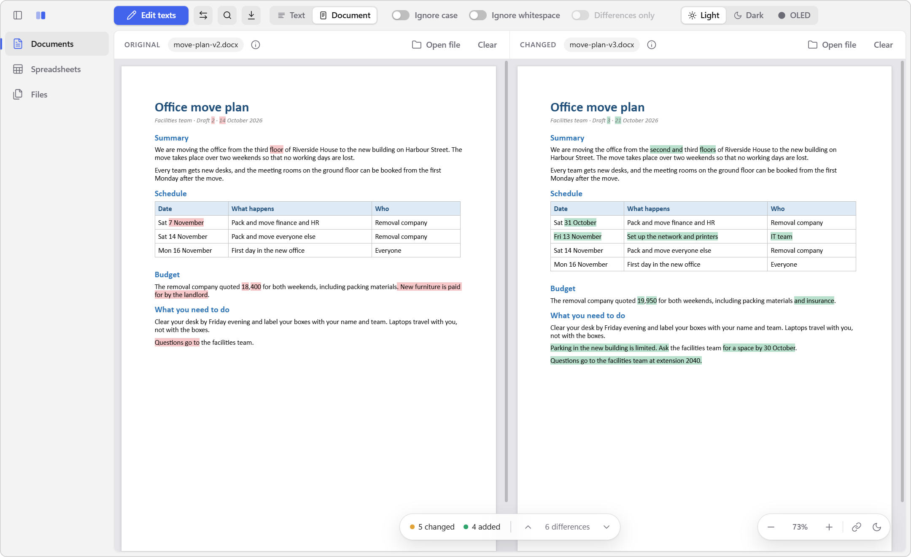
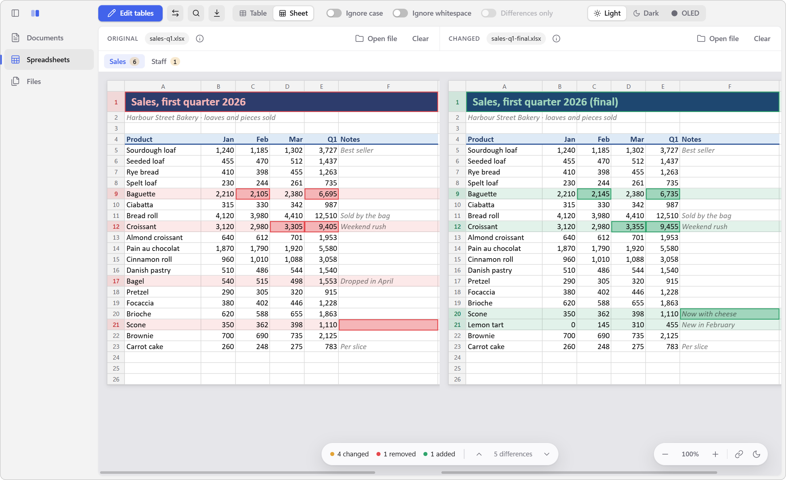
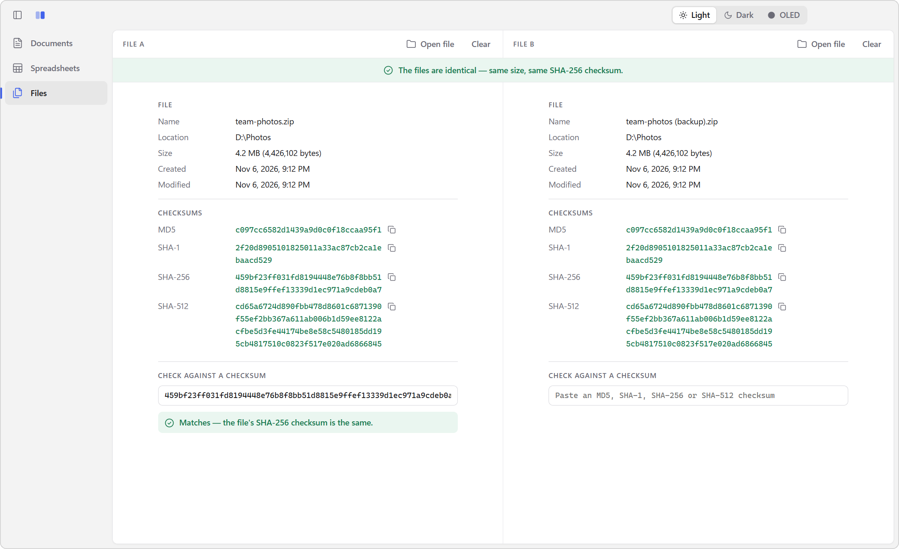

# Compare

**See what changed between two documents, spreadsheets or files.** 
A free Windows app that shows them side by side and marks every difference.

[**Download**](https://github.com/mikep49/compare/releases/latest) · [User guide](docs/guide.md) · [How it works](docs/guide.md#how-it-works)

 

<picture>
  <source media="(prefers-color-scheme: dark)" srcset="docs/images/document-dark.png">
  
</picture>

## Documents

Compare **Word files, PDFs and plain text**. See them as they look, page by page, with removed words in red and added words in green. Or switch to the Text view to see them line by line. You can also paste text straight in.

## Spreadsheets

Compare **Excel, OpenDocument and CSV** files cell by cell and sheet by sheet. Workbooks look the way they do in Excel, with their fonts, colors, borders and merged cells, and every changed cell, row and column is marked.

<picture>
  <source media="(prefers-color-scheme: dark)" srcset="docs/images/sheet-dark.png">
  
</picture>

## Files

Find out if **any two files** are identical, or check a download against the MD5, SHA-1, SHA-256 or SHA-512 checksum its website publishes.

<picture>
  <source media="(prefers-color-scheme: dark)" srcset="docs/images/files-dark.png">
  
</picture>

## And also

- **Jump between changes** with F8, and **find** text on both sides
- **Export** an HTML report, a patch file, or a CSV list of the changed cells
- **Ignore** case or whitespace, or show only the differences
- **Light, dark and OLED-black** themes, and dark pages for documents and sheets
- **Open from Explorer**: select two files and choose *Send to → Compare*
- **Private**: your files never leave your computer

## Download

Get the latest version from the [Releases page](https://github.com/mikep49/compare/releases/latest):

- **Compare-Setup-x.x.x.exe** installs the app and adds it to Explorer's *Send to* menu.
- **Compare-Portable-x.x.x.exe** runs without installing.

The app isn't code-signed, so Windows SmartScreen may warn you the first time you run it. Click **More info → Run anyway**.

From then on, Compare updates itself: when a new version is out, an **Update** button shows at the bottom left. This works for both the installer and the portable exe.

New to Compare? The [user guide](docs/guide.md) covers everything it can do.

## License

MIT. See [LICENSE](LICENSE).
