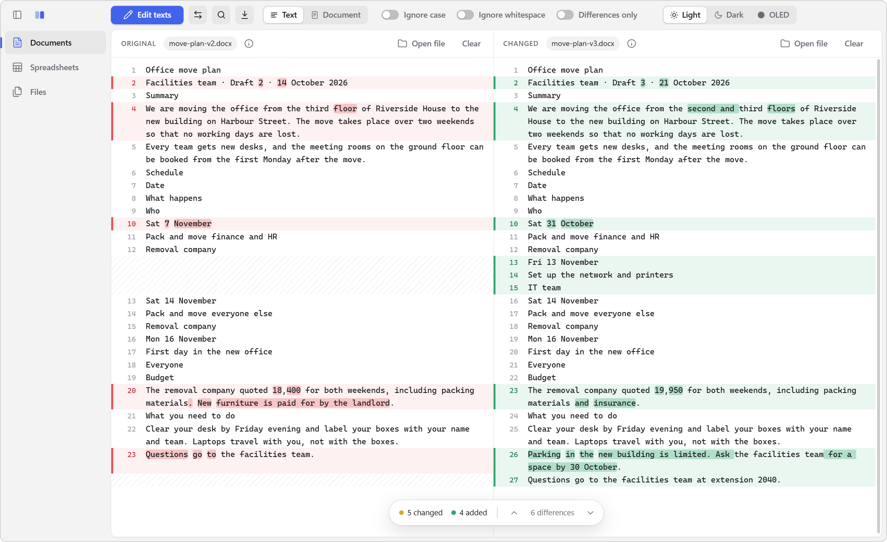
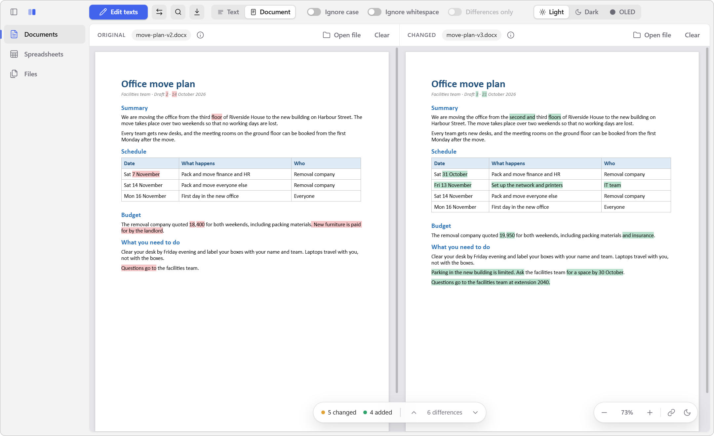
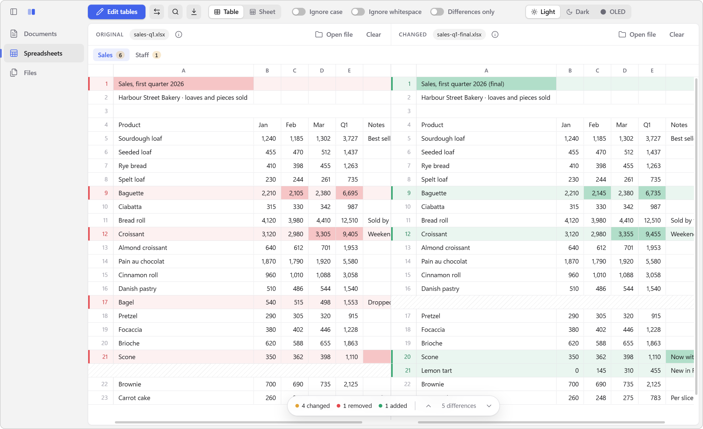
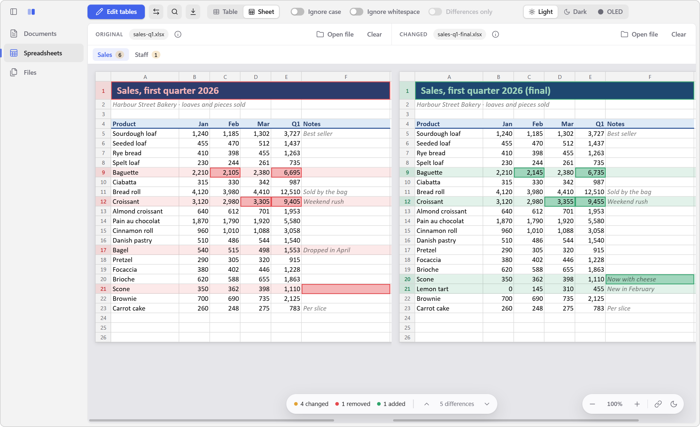
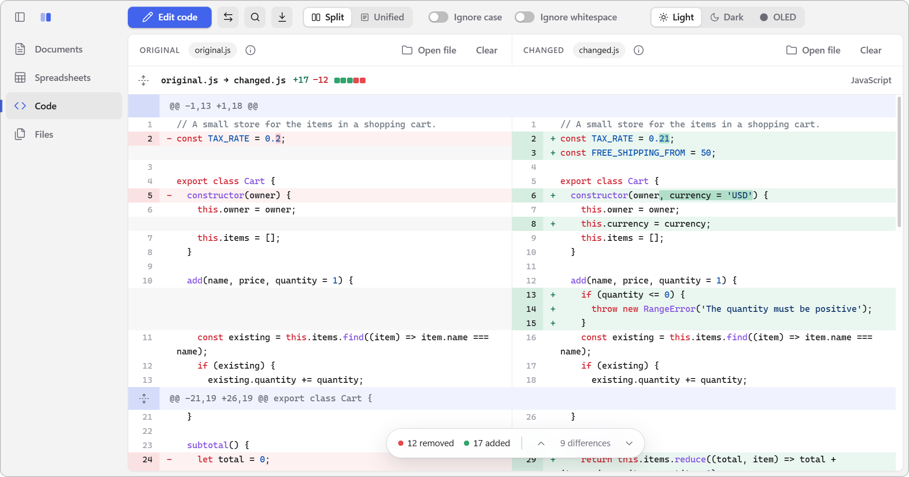
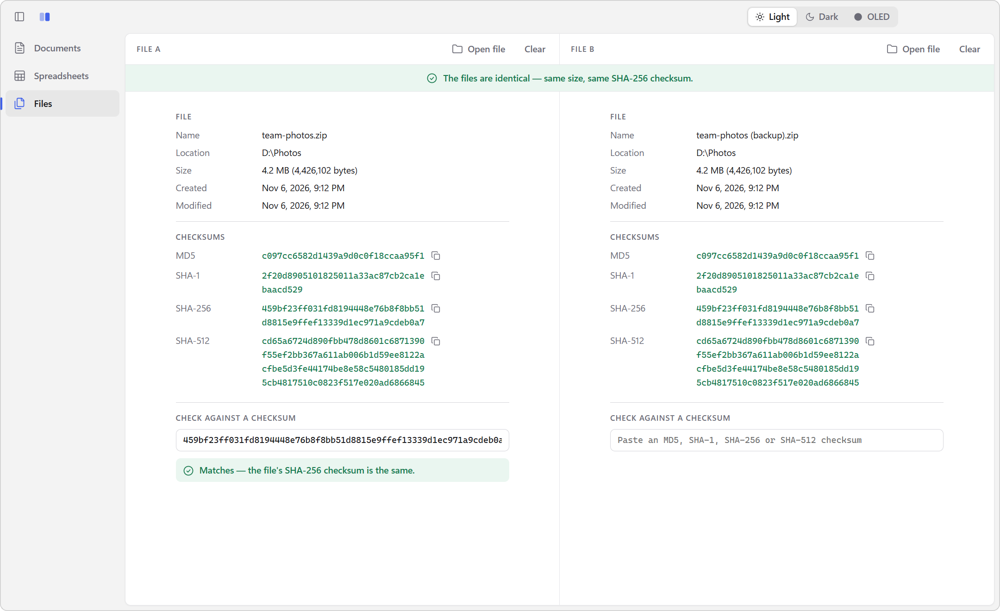

# Compare user guide

Compare shows two versions of something side by side and marks what changed. This guide covers how to use it, then how it works inside.

**Using Compare**

- [Getting started](#getting-started)
- [Opening files](#opening-files)
- [Documents](#documents)
- [Spreadsheets](#spreadsheets)
- [Code](#code)
- [Files and checksums](#files-and-checksums)
- [Options](#options)
- [Moving around](#moving-around)
- [Exporting](#exporting)
- [Themes and dark pages](#themes-and-dark-pages)
- [Keyboard shortcuts](#keyboard-shortcuts)
- [Updates](#updates)
- [Troubleshooting](#troubleshooting)

**How it works**

- [Overview](#overview)
- [Reading files](#reading-files)
- [Comparing text](#comparing-text)
- [Showing documents as they look](#showing-documents-as-they-look)
- [Comparing spreadsheets](#comparing-spreadsheets)
- [Comparing code](#comparing-code)
- [Checksums](#checksums)
- [Updating itself](#updating-itself)
- [Privacy and settings](#privacy-and-settings)
- [Project layout](#project-layout)
- [Building, testing and releasing](#building-testing-and-releasing)

---

# Using Compare

## Getting started

1. **Pick what to compare** in the sidebar: **Documents**, **Spreadsheets**, **Code** or **Files** (Ctrl+1 to Ctrl+4). Each keeps its own two sides, so you can switch between them without losing anything.
2. **Fill both sides.** The left side is the *original* and the right side is the *changed* version. Paste text or cells, drop a file onto a side, or click **Open file**.
3. **Click Compare** (Ctrl+Enter).

Removed and changed text is marked in **red** on the original. Added and changed text is marked in **green** on the changed side. The bar at the bottom counts the changes, and its arrows take you from one change to the next.

To change what's being compared, click **Edit texts**, **Edit tables** or **Edit code** (Ctrl+Enter again). **⇄** swaps the two sides and **Clear** empties one; for a few seconds after, **Undo** in the message or Ctrl+Z brings it back. The **ⓘ** button next to a file's name shows its details: its size and dates, and for Word files and PDFs their title, author, pages and so on.

## Opening files

- **Drop files** onto a side. Dropping two files at once fills both sides.
- **Open file** above each side.
- **From Explorer**: select one or two files, right-click, and choose **Send to → Compare**. The installer adds this to the menu.
- **Drop files onto the app's icon**, or run `Compare.exe original.docx changed.docx`.

If Compare is already open, files sent to it this way open in the same window. Compare picks the right workspace from the file type: Word files and PDFs go to Documents, workbooks to Spreadsheets, and source code (`.js`, `.py`, `.cs`, `.ps1`, `.json`, `.html` and so on) to Code. Files from Explorer that are none of these go to **Files**, where they're compared by checksum. Anything you drop into the Files workspace stays there.

What each workspace can open:

| Workspace | Files |
| --- | --- |
| Documents | Word (`.docx`), PDF, and any plain text file (UTF-8, UTF-16 or Windows-1252) |
| Spreadsheets | Excel (`.xlsx`, `.xlsm`, `.xlsb`, `.xls`), OpenDocument (`.ods`, `.fods`), CSV and TSV |
| Code | Any plain text file, CSV files included |
| Files | Any file |

Older and other formats such as `.doc`, `.rtf`, `.odt`, `.pages` and PowerPoint files can't be read as documents. Save them as `.docx` or PDF first.

## Documents

When you compare Word files or PDFs, the **Text | Document** switch in the top bar changes how they're shown. Compare remembers which one you used last.

### Text view



The Text view shows the text of both sides line by line, with line numbers. In Word files, each paragraph is one line. Lines that changed are paired up and the words that changed are highlighted. When two lines have very little in common, the whole line is marked instead.

Paragraphs always line up side by side, however many blank lines there are between them. Blank lines never count as differences.

### Document view



The Document view shows the files themselves, pages and all, with the same changes marked on them.

- Each document **scrolls on its own**: the mouse wheel moves the one it's over. The **link** button at the bottom right makes them scroll together.
- The pages **fit the width** of the window. Zoom with **−** and **+**, or with **Ctrl+mouse wheel** over the documents. Click the zoom level to fit the pages to the width again.
- A side with pasted or typed text is shown as a page of plain text.

## Spreadsheets

When you compare Excel or OpenDocument workbooks, the **Table | Sheet** switch does the same for spreadsheets.

### Table view



The Table view lines up the rows of both sheets side by side. Changed cells are highlighted, and rows and columns only one side has are marked as removed or added.

### Sheet view



The Sheet view shows each spreadsheet the way Excel does, with its column widths, row heights, fonts, fill colors, borders, merged cells and gridlines. Changes are marked on top: red on the original and green on the changed one.

- Each sheet scrolls on its own, or together with the **link** button, like the Document view.
- Zoom with **−** and **+**, or with **Ctrl+mouse wheel** over the sheets. Click the zoom level to go back to 100%.
- Rows and columns hidden in a workbook stay hidden, unless something changed in them.
- Excel files (`.xlsx`, `.xlsm`) show all of their formatting. `.xls`, `.xlsb` and `.ods` files show their column widths, row heights and merged cells. Pasted cells and CSV files are shown as a plain sheet.

### Sheets and cells

- The **tabs** above the sheets list every sheet, with the number of differences in each. Sheets are paired by name. A sheet only one workbook has is shown as removed or added.
- **Cells are compared by what they show**: numbers as formatted, and formulas by their result. A changed formula that gives the same result isn't a difference, and neither is a change to a cell's formatting alone.
- A column inserted or deleted in one sheet doesn't throw off the rest. Compare lines the columns up first, then the rows.

## Code



The **Code** workspace compares source code the way GitHub shows the changes of a pull request. Open, drop or paste the two versions and click **Compare**.

- **Split | Unified** in the top bar shows the two versions side by side, or the changes in one column with the removed lines above the added ones. Compare remembers which one you used last.
- Each change comes with **three lines around it**, in a hunk. The hunk's header, such as `@@ -21,19 +26,19 @@ export class Cart {`, says where it starts on each side, how many lines it has there, and the function it's in, as `git diff` does.
- The lines between the hunks are **folded away**. The arrow buttons next to a hunk's header bring back 20 lines above or below at a time, or all of them when there are only a few. The button at the left of the file's header unfolds the whole file, and folds it back again.
- The code is **colored** in GitHub's colors, by the language its file name tells. Pasted code is recognized by what it looks like, and code pasted next to an opened file takes that file's language. The language shows at the right of the file's header.
- Changed lines show the **words that changed** in a darker shade. When two lines have little in common, they're just marked as removed and added.
- The file's header counts the **lines added and removed**, with GitHub's five squares.
- Unlike in documents, **every line counts**, blank lines too, and so does a missing line break at the end of a file. A ⊖ at the end of a line marks it as the last line of a file without one.
- In the Split view, selecting text on one side leaves the other alone, so you can copy the code of one version.
- Code is colored up to 2 MB. Larger files are still compared, just in plain text.

## Files and checksums



The **Files** workspace works with any kind of file. Drop or open one file on each side, and Compare tells you whether they're **identical**: same size and same SHA-256 checksum. Each side lists the file's size, dates and its MD5, SHA-1, SHA-256 and SHA-512 checksums, each with a copy button.

**To check a download**, open just that one file and paste the checksum from the website into **Check against a checksum**. Compare works out which kind of checksum it is from its length and tells you if it matches.

Files are read from disk a piece at a time, so even very large files work, with a progress count while they're read.

## Options

The switches in the top bar apply to documents, spreadsheets and code:

- **Ignore case**: `Hello` and `hello` count as the same.
- **Ignore whitespace**: spaces at the start and end of a line or cell don't count, and a run of spaces counts as one. For code, so does a missing line break at the end of a file.
- **Differences only**: in the Text and Table views, hides everything that didn't change, except three lines around each change. The Document and Sheet views keep the pages whole and gray out the lines and rows that didn't change instead, so the changes stand out. Code always shows its changes in hunks, so the switch isn't there.

Compare remembers these settings.

## Moving around

- **F8** and **Shift+F8**, or the arrows in the bottom bar, go to the next and previous change.
- **Ctrl+F** finds text on both sides. **Enter** and **Shift+Enter** (or F3 and Shift+F3) go to the next and previous match, and **Esc** closes the search bar. Find works in the Text, Document, Table and Sheet views, and in code, where it searches the lines that aren't folded away.
- **Ctrl+Plus**, **Ctrl+Minus** and **Ctrl+0** zoom the whole window. Over the Document and Sheet views, Ctrl+mouse wheel zooms the pages instead.
- **Ctrl+B** collapses the sidebar to give the comparison more room.

## Exporting

Click the **download** button in the top bar, or press **Ctrl+S**:

- **HTML report**: both sides with the changes marked, to read, share or print. Works for documents, spreadsheets and code. For code, it shows the hunks as you see them, unfolded lines included, split or unified, in color.
- **Patch file** (documents and code): the changes as a unified diff, the format `git` and other tools use. It includes the blank lines too, so it turns the original into the changed text exactly. For code, the hunk headers name the function each hunk is in, and a missing line break at the end is marked as `git` marks it.
- **List of changes** (spreadsheets): a CSV file with every changed cell, row and column, to open in Excel.

Compare remembers the folder you last saved to.

## Themes and dark pages

The **Light**, **Dark** and **OLED** buttons at the top right change the app's colors. OLED is pure black. The first time, Compare follows your Windows setting.

The **moon** button at the bottom right of the Document and Sheet views shows pages dark, with their colors turned around. Click it again for light pages. Pictures in Word files keep their colors. A PDF page is drawn as a single picture, so photos in PDFs are turned around too.

Compare also remembers its window size and position, its zoom, and which workspace and views you used last.

## Keyboard shortcuts

| Shortcut | Action |
| --- | --- |
| Ctrl+Enter | Compare / back to editing |
| F8 / Shift+F8 | Next / previous change |
| Ctrl+F | Find |
| Enter / Shift+Enter, F3 / Shift+F3 | Next / previous match |
| Esc | Close the search bar |
| Ctrl+S | Export |
| Ctrl+1, Ctrl+2, Ctrl+3, Ctrl+4 | Documents, Spreadsheets, Code, Files |
| Ctrl+B | Collapse or expand the sidebar |
| Ctrl+Plus / Ctrl+Minus / Ctrl+0 | Zoom in / out / reset |
| Ctrl+mouse wheel | Zoom (the pages, over the Document and Sheet views) |

## Updates

When a new version of Compare is out, an **Update to x.x.x** button shows at the bottom left of the window. Compare checks for one when it starts, and every six hours while it's open.

1. **Click Update.** The new version downloads in the background, and you can go on working. The button shows how far the download has got.
2. **Click Restart to update.** Compare closes and opens again on the new version. If you'd rather not restart now, just carry on: the update goes in when you close Compare.

This works the same for the installed app and the portable exe. The portable exe is replaced by the new one in the same folder. If it was still called *Compare-Portable-1.2.0.exe*, the new one takes the new version's name; if you renamed it, it keeps your name. The portable app takes half a minute or so to open again, because it unpacks itself first.

If Compare can't update itself, the button opens the download page instead. That happens with the zip build, and with a portable exe in a folder Compare can't write to.

## Troubleshooting

**Windows SmartScreen warns me when I start the app.** The app isn't code-signed. Click **More info → Run anyway**.

**"This file is password-protected."** Open it in Word, Excel or your PDF app, remove the password, save it and try again.

**"This PDF has no text to compare."** The PDF is made of scanned pages, which are pictures of text. Compare can only compare PDFs that contain real text.

**"This doesn't look like a text file."** The Documents and Code workspaces can't read this file type. To check whether two such files are the same, use the **Files** workspace.

**The changes look odd in a very large file.** When two long texts have almost nothing in common, lining them up can take very long. After three seconds, Compare stops trying and compares the lines in order instead.

---

# How it works

## Overview

Compare is an [Electron](https://www.electronjs.org/) app: a desktop app built with web technology. It has three parts:

- **The main process** (`src/main.js`) opens the window, remembers settings, shows the save dialog, works out checksums, and takes in files from Explorer. Only one copy of the app runs: starting it again hands the files to the window that's already open.
- **The file reader** (`src/parse-worker.js`) reads files in a separate background process, and colors code there too. A big workbook, PDF or source file never freezes the window while it loads. If the reader ever crashes, say on a file too big for memory, it simply starts again for the next file.
- **The page** (`src/renderer/`) is what you see. It compares the two sides and draws the results.

## Reading files

`src/parse-file.js` turns each file into something to compare:

- **Word files**: [mammoth](https://github.com/mwilliamson/mammoth.js) pulls out the text, one paragraph per line.
- **PDFs**: [pdf.js](https://mozilla.github.io/pdf.js/) reads the text of each page.
- **Spreadsheets**: [SheetJS](https://sheetjs.com/) reads each sheet as rows of cells. Each cell holds the text a spreadsheet app would show, with numbers formatted and formulas replaced by their results. For Excel files, `src/sheet-look.js` also reads the formatting straight from the file's XML: column widths, row heights, fonts, fills, borders, alignment and merged cells.
- **Plain text** is read as UTF-16 when it starts with a byte order mark, as UTF-8 when it is valid UTF-8, and as Windows-1252 otherwise. CSV files have their delimiter (comma, semicolon, tab or pipe) worked out from their first lines.

The file's details (size, dates, author, page count, encoding and so on) are gathered on the way for the **ⓘ** button.

## Comparing text

`src/renderer/diff-engine.js` compares two texts in a few steps:

1. Split both texts into lines, and set the blank ones aside.
2. Find the longest run of lines the two have in common, using the [jsdiff](https://github.com/kpdecker/jsdiff) library. Every other line is either removed or added.
3. Where some lines were removed and others added in the same place, pair them up as **changed** lines. The leftovers stay removed or added.
4. Compare each pair of changed lines **word by word** to highlight just the words that differ. When less than 30% of the words match, the lines have little to do with each other, and the whole line is marked instead.
5. Put the blank lines back next to each other. Where one side has fewer of them, it gets empty space instead, so the paragraphs after them still line up.

Ignore case and Ignore whitespace work by comparing lowercased or tidied copies of each line, while still showing the original. If texts with almost nothing in common take more than three seconds to line up, their lines are compared in order instead, so the app never hangs.

## Showing documents as they look

The Document view shows the real pages: [docx-preview](https://github.com/VolodymyrBaydalka/docxjs) lays out Word files as HTML, and pdf.js draws PDF pages (`src/renderer/doc-sources.js`). The comparison was made on the text read from the file, though, and the page shows that text differently: lines break in other places, and there may be headers and footers too.

`src/renderer/doc-align.js` bridges the two. It lines up the compared text with the text on the pages character by character, leaving out whitespace, and carries each change across. `src/renderer/doc-view.js` then draws the red and green marks on top of the pages, and keeps both sides in step when they scroll together.

The Sheet view (`src/renderer/sheet-view.js`) does the same for spreadsheets, using the formatting read by `sheet-look.js`. It only draws the rows and columns on screen, so huge sheets stay fast. The Table view (`src/renderer/table-view.js`) works the same way.

## Comparing spreadsheets

`src/renderer/table-diff.js` compares two workbooks:

1. **Pair the sheets**: first by name, then any sheets left over in order.
2. **Line up the columns.** Two columns count as the same one when they share most of their values, and a matching heading helps. That way, a column inserted on one side shows up as one added column, not as a change in every column after it.
3. **Line up the rows** on the columns both sheets have, the same way as lines of text. Where rows were removed and added in the same place, the most similar pairs (at least half their cells the same) become **changed** rows. The others stay removed or added.
4. **Compare the cells** of each changed row to find the ones that differ.

## Comparing code

`src/renderer/code-diff.js` compares code the way `git diff` does, which differs from documents in a few ways:

1. **Every line counts.** Blank lines are compared like any other, and a file whose last line has no line break differs from one whose last line has.
2. The longest run of lines the two have in common is found with jsdiff, as for documents.
3. **Runs of added or removed lines are slid into place.** Code repeats lines such as `}` and blank lines a lot, so a function added between two others could be shown starting at the closing brace of the one before it. Like git's compaction heuristic, Compare moves each such run as far down as it can, or up from there to the nearest place where it ends with a blank line.
4. Removed and added lines in the same place are paired as changed lines, and compared word by word, as for documents. Lines with little in common aren't marked word by word.
5. The changes are shown in **hunks**, with three unchanged lines around each. A hunk's header gives where it starts and how many lines it has on each side, and the nearest line before it that starts a function, which is, as in git, the nearest line that starts with a letter, `_` or `$`.

The code is colored with [highlight.js](https://highlightjs.org/) (`src/highlight-code.js`), in the background process, so that a large file doesn't hold up the window. `src/code-languages.js` tells the language from the file's name. Code without one is recognized by highlight.js from its first 20,000 characters, and left plain when no language fits it well. `src/renderer/code-html.js` then cuts the colored code into lines and marks the changed words in them, and `src/renderer/code-view.js` draws the hunks.

## Checksums

`src/hash-file.js` reads a file in 1 MB pieces and works out its MD5, SHA-1, SHA-256 and SHA-512 checksums in a single pass, so a large file is only read once. Two files are identical when they have the same size and the same SHA-256 checksum. A pasted checksum is recognized by its length: 32, 40, 64 or 128 hexadecimal digits.

## Updating itself

`src/updater.js` asks GitHub for the latest release ([the releases API](https://docs.github.com/en/rest/releases/releases#get-the-latest-release)) a few seconds after starting and every six hours. Only plain versions count, so drafts and pre-releases are never offered. `src/update.js` holds the parts that don't need Electron, so they can be tested: comparing versions, picking the right file, and the swap script.

How the update is put in place depends on how Compare runs:

- **Installed**: the update is `Compare-Setup-x.x.x.exe`, downloaded to the temp folder. It runs silently with `--updated /S`, and with `--force-run` to start the app again afterwards.
- **Portable**: the portable exe unpacks itself to a temp folder each time it runs, and tells the app where it really is in `PORTABLE_EXECUTABLE_FILE`. The new `Compare-Portable-x.x.x.exe` is downloaded next to it, with `.compare-update` added to its name. Once the app quits, a small PowerShell script waits for the old exe to be unlocked, puts the new one in its place and, for a restart, starts it.
- **Anything else** (the zip build): the button opens the release page.

Every download is checked against the size and SHA-256 checksum GitHub lists for the file before it's used. Unfinished downloads are cleared away at the next start.

Started straight from the app, PowerShell would either be closed along with it (Node ties child processes to their parent on Windows) or, started detached, have no console and quit at once. So the app starts a PowerShell that starts a second, hidden one, and waits only for the first. The file paths go to the script in environment variables, so no quoting can go wrong, whatever the folder is called.

## Privacy and settings

Everything happens on your computer, and Compare never uploads your files. The only time it goes online is to ask GitHub whether a new version is out, and to download one when you click **Update**. The page isn't allowed to load anything from outside the app at all.

Settings are stored in two places in Electron's user data folder under `%APPDATA%`. The main process keeps the window's size and position, the zoom and the last export folder in `settings.json`. The page keeps the theme, views, options and sidebar state in its own local storage.

## Project layout

| Path | What it does |
| --- | --- |
| `src/main.js` | Main process: window, settings, dialogs, checksums, files from Explorer |
| `src/preload.js` | The bridge between the page and the main process |
| `src/parse-worker.js` | Background process that reads files |
| `src/parse-file.js` | Reads Word, PDF, text and spreadsheet files |
| `src/highlight-code.js` | Colors code with highlight.js |
| `src/code-languages.js` | Tells the language of a source file from its name |
| `src/sheet-look.js` | Reads the formatting of spreadsheets |
| `src/table-text.js` | Turns spreadsheets into delimited text and back |
| `src/hash-file.js` | Works out checksums |
| `src/updater.js` | Checks for updates, downloads and applies them |
| `src/update.js` | Versions, release files and the swap script for updates |
| `src/renderer/app.js` | The page: workspaces, top bar, keyboard, find, export |
| `src/renderer/diff-engine.js` | Compares texts line by line and word by word |
| `src/renderer/table-diff.js` | Compares spreadsheets sheet by sheet |
| `src/renderer/code-diff.js` | Compares code as git does, in hunks; writes code patches |
| `src/renderer/code-html.js` | Turns colored code into lines, with the changed words marked |
| `src/renderer/code-view.js` | The code view, split or unified |
| `src/renderer/find-text.js` | Find in the text and code views |
| `src/renderer/doc-align.js` | Carries text changes over to the pages of a document |
| `src/renderer/doc-sources.js` | Lays out Word files and PDFs as pages |
| `src/renderer/doc-view.js` | The Document view |
| `src/renderer/sheet-view.js` | The Sheet view |
| `src/renderer/table-view.js` | The Table view |
| `src/renderer/report.js` | HTML reports, text patch files and CSV lists of changes |
| `build/installer.nsh` | Adds *Send to → Compare* when installing |
| `test/` | Tests, run with Node's built-in test runner |

## Building, testing and releasing

You need [Node.js](https://nodejs.org/).

```
npm install
npm start                # run the app
npm test                 # run the tests
npm run dist:installer   # build the installer and portable exe into dist/
```

To publish a release, set `version` in `package.json`, write the release notes in `docs/releases/v1.3.0.md` (named after the tag), commit, then push a matching tag:

```
git tag v1.3.0
git push origin v1.3.0
```

GitHub Actions runs the tests, builds the installer and the portable exe, and publishes them as a release with those notes. Without a notes file, the release lists the merged pull requests instead. The tests also run on every push to `main` and on every pull request.
